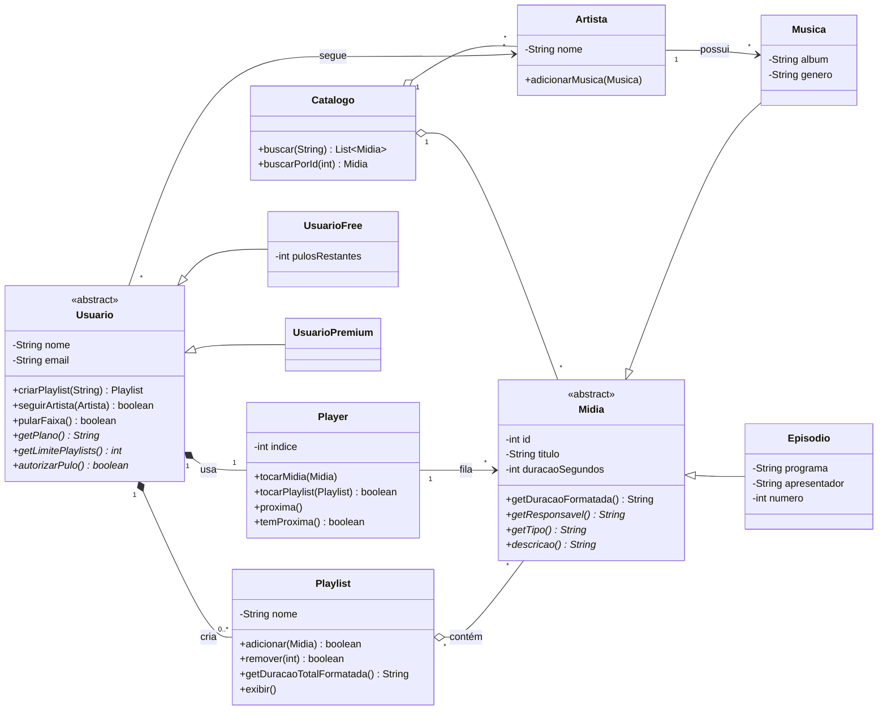

# Diagrama de classes - Spotify (perspectiva do usuário)

Cole o bloco abaixo em https://mermaid.live (ou veja direto no GitHub) para gerar a imagem.

## Relações

| Relação | Tipo | Cardinalidade |
|---|---|---|
| Musica e Episodio herdam de Midia | Herança | - |
| UsuarioFree e UsuarioPremium herdam de Usuario | Herança | - |
| Artista - Musica | Associação | 1 para N |
| Usuario - Playlist | Composição | 1 para N |
| Playlist - Midia | Agregação | N para N |
| Usuario - Artista (segue) | Associação | N para N |
| Usuario - Player | Composição | 1 para 1 |
